# «Истинный интеллект» — аналитический кабинет (MVP)

Кабинет для клиентов с сетью филиалов: показатели присутствия на геосервисах (просмотры карточек, переходы на сайт, звонки, маршруты, рейтинг, отзывы), фильтрация по филиалу и периоду, график динамики и модуль работы с отзывами.

**Стек:** Next.js 15 + React 19 + TypeScript · NestJS 11 + TypeORM · PostgreSQL 16 · Docker Compose. Стек соответствует ТЗ, отступлений нет.

**Дополнительное задание:** сделаны **оба варианта**:
- **А.** Модуль отзывов: фильтрация по рейтингу и статусу обработки, смена статуса, ответ на отзыв.
- **Б.** Имитация внешнего API геосервиса (отдельный сервис `geo-mock`). Система получает из него статистику, сохраняет её в БД и корректно обрабатывает повторные запросы: дубли не создаются, работает `Idempotency-Key`, параллельные запуски блокируются, сбои API переживаются ретраями.

---

## Быстрый старт

Нужен только Docker (с Compose v2).

```bash
docker compose up -d --build
```

| Сервис   | Адрес                            |
|----------|----------------------------------|
| Кабинет  | http://localhost:3000            |
| REST API | http://localhost:3001/api        |
| Health   | http://localhost:3001/api/health |
| Имитация внешнего API | http://localhost:4010 (ключ `mock-geo-key`) |

При первом старте backend сам применяет миграции и заполняет базу тестовыми данными. Если данные уже есть, сид пропускается. Сид выполняется под advisory-lock, поэтому одновременный старт нескольких экземпляров безопасен.

Имитация API по умолчанию намеренно отклоняет ~20% запросов (503/429), чтобы были видны ретраи. Это настраивается: `MOCK_GEO_FAILURE_RATE=0 docker compose up -d`.

Настройки запуска:
- **`JWT_SECRET`.** Если переменная не задана, backend при каждом старте генерирует случайный ключ, поэтому после перезапуска нужно войти заново. При нескольких экземплярах backend ключ обязателен: иначе токен одного экземпляра не примет другой. Для постоянного развёртывания задайте свой ключ: `JWT_SECRET=$(openssl rand -base64 48) docker compose up -d`. Известные примеры и ключи короче 32 символов в production отвергаются, и backend не стартует.
- **`DB_PORT`.** Если порт 5432 на машине занят (например, локальным PostgreSQL), выберите другой: `DB_PORT=5433 docker compose up -d`. Сервисы внутри Docker это не затрагивает. Для локальной разработки и тестов вне Docker поменяйте порт и в `DATABASE_URL` / `DATABASE_URL_TEST`.
- **Адрес UI.** Открывайте UI по `http://localhost:3000` (CORS также разрешает `http://127.0.0.1:3000`).

### Тестовые учётные записи (все данные вымышленные)

| Роль          | Email                | Пароль      | Видит                       |
|---------------|----------------------|-------------|-----------------------------|
| Администратор | `admin@example.com`  | `admin123`  | все 3 компании, 7 филиалов  |
| Клиент        | `veter@example.com`  | `client123` | Кофейня «Северный ветер» (3 филиала) |
| Клиент        | `gaika@example.com`  | `client123` | Автосервис «Гайка» (2 филиала) |
| Клиент        | `ulybka@example.com` | `client123` | Стоматология «Улыбка+» (2 филиала) |

На странице входа есть кнопки, которые подставляют эти доступы.

### Автотесты

```bash
# Внутри Docker (поднимет БД, если её нет)
docker compose --profile test run --rm --build tests

# Или локально (нужен Node 22+ и запущенный контейнер db)
docker compose up -d db
cd backend && npm ci && npm test
```

E2E-тесты работают с отдельной базой `analytics_test`: перед прогоном схема пересоздаётся миграциями. Для защиты есть проверка: тесты откажутся работать с базой, имя которой не оканчивается на `_test`.

### Локальная разработка без Docker для приложений

```bash
docker compose up -d db
cd backend  && npm ci && cp .env.example .env && npm run migrate && npm run seed && npm run start:dev
cd backend  && npm run mock-geo     # имитация внешнего API на :4010
cd frontend && npm ci && npm run dev
```

Полезные команды backend:
- `npm run seed:reset` пересоздаёт тестовые данные;
- `npm run test:unit` запускает только unit-тесты;
- `npm run sync:all -- --days 3` синхронизирует все подключённые филиалы. Это точка входа для cron; в Docker: `docker compose exec backend node dist/sync/sync-all.js --days 3`.

---

## Скриншоты

| | |
|---|---|
| 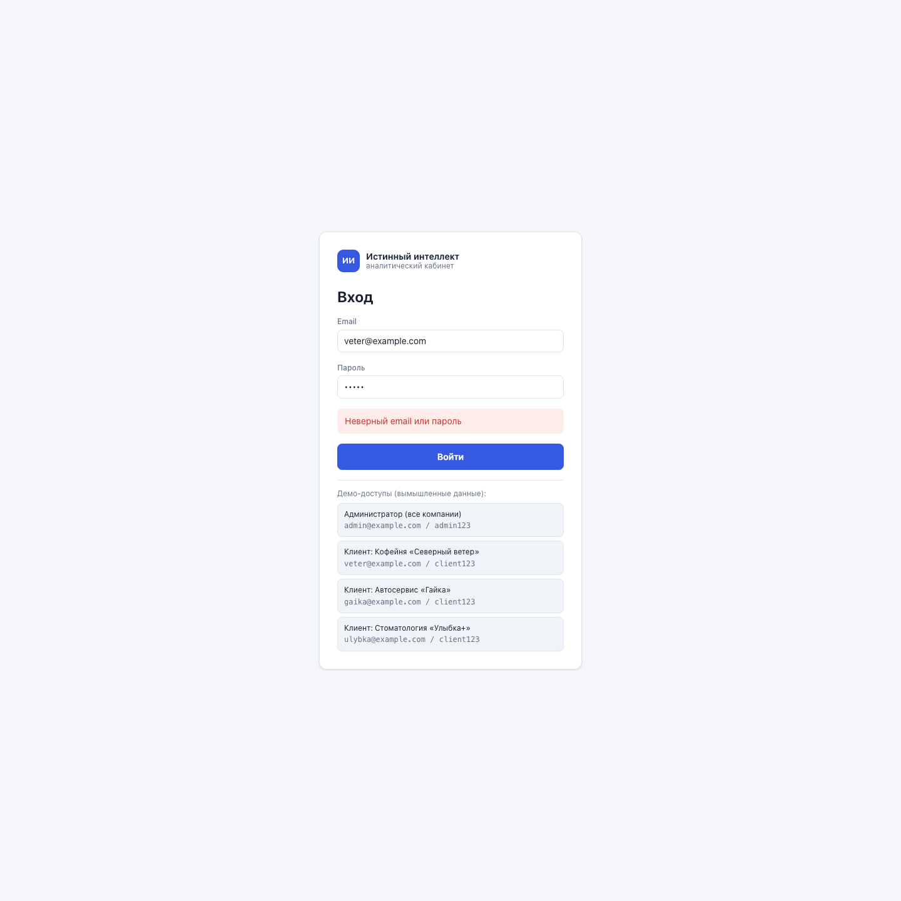 Вход, ошибка неверного пароля | 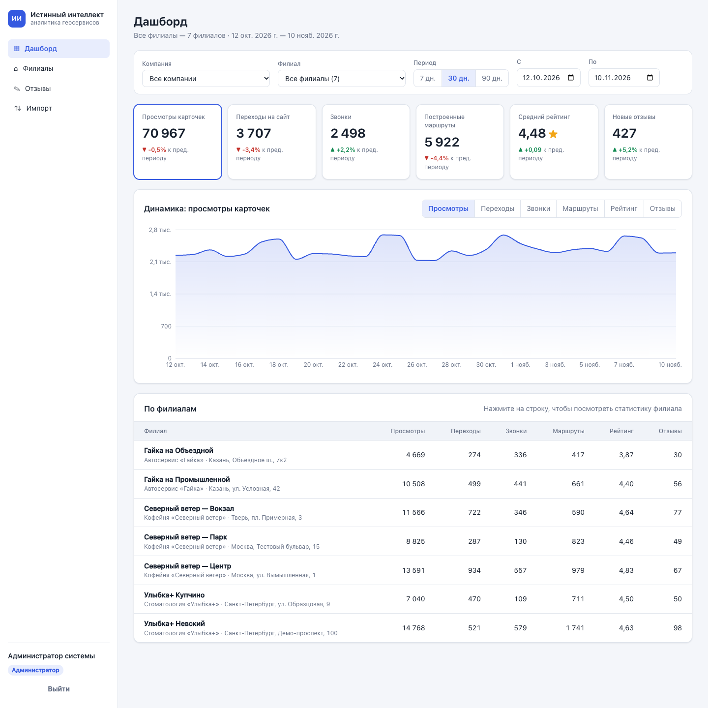 Администратор: агрегат по всем компаниям |
| 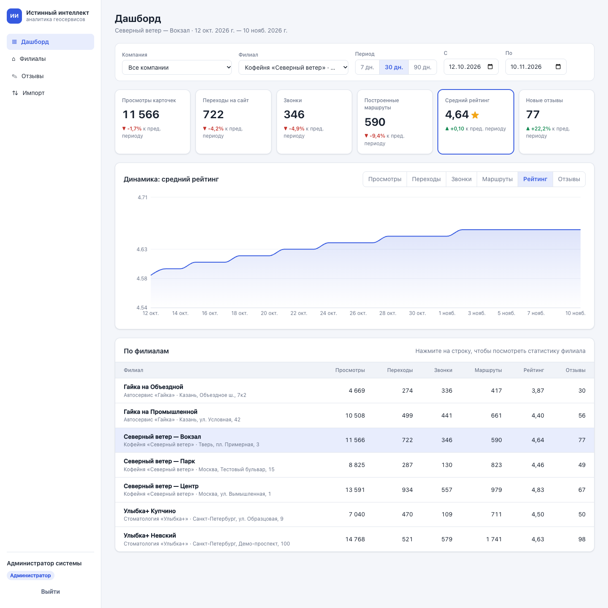 Выбран филиал, график рейтинга | 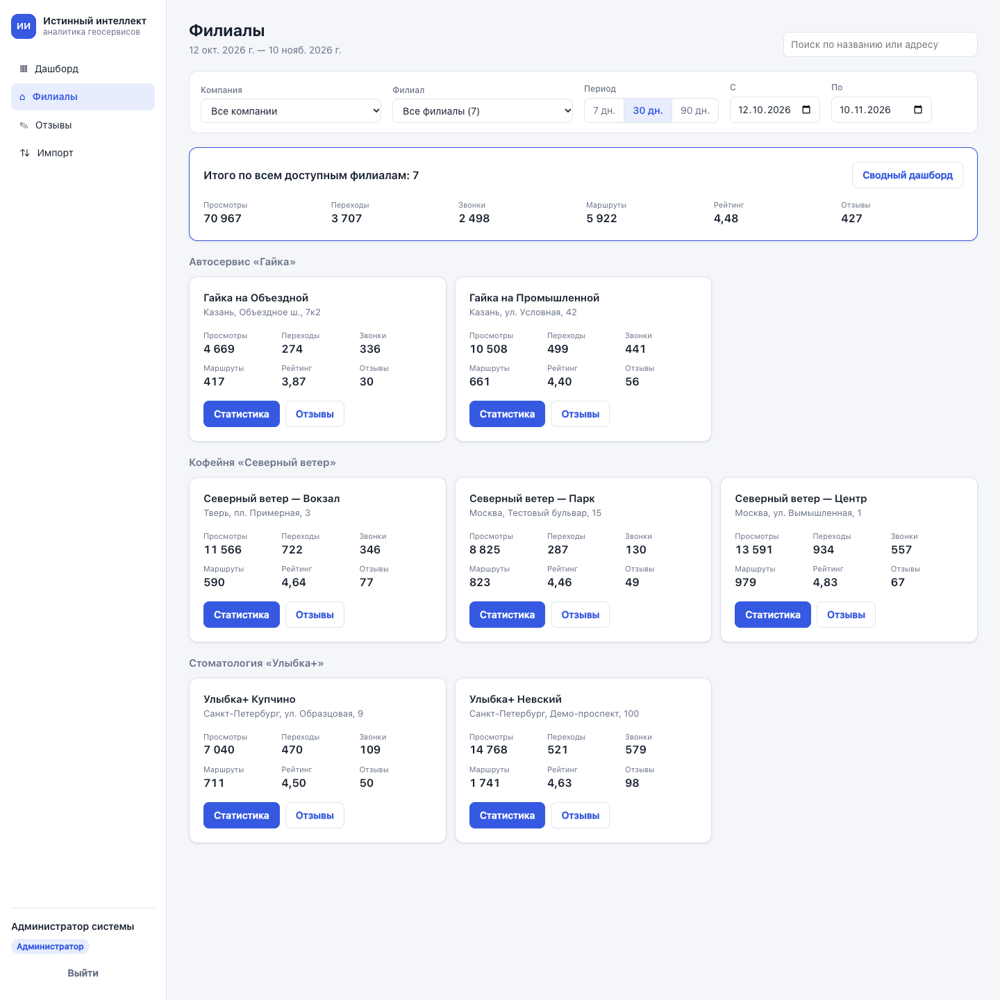 Список филиалов с итогами |
| 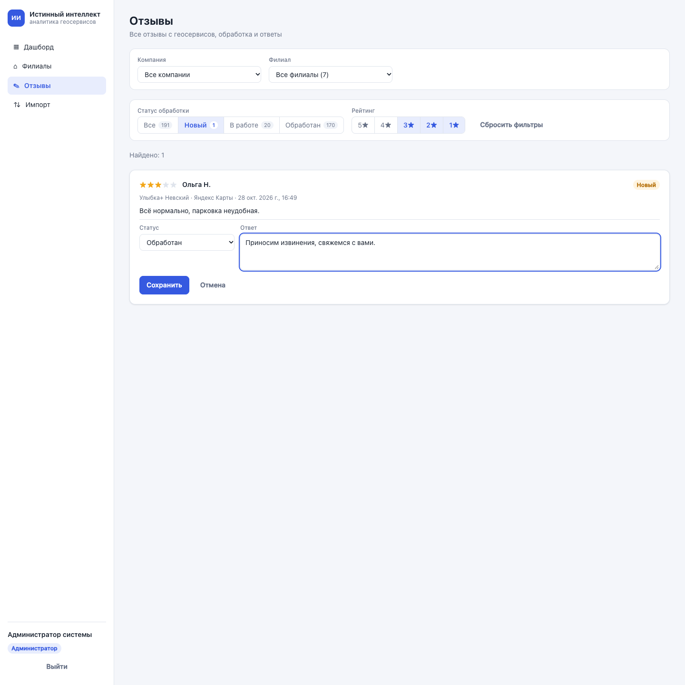 Отзывы: фильтры по статусу и рейтингу, обработка | 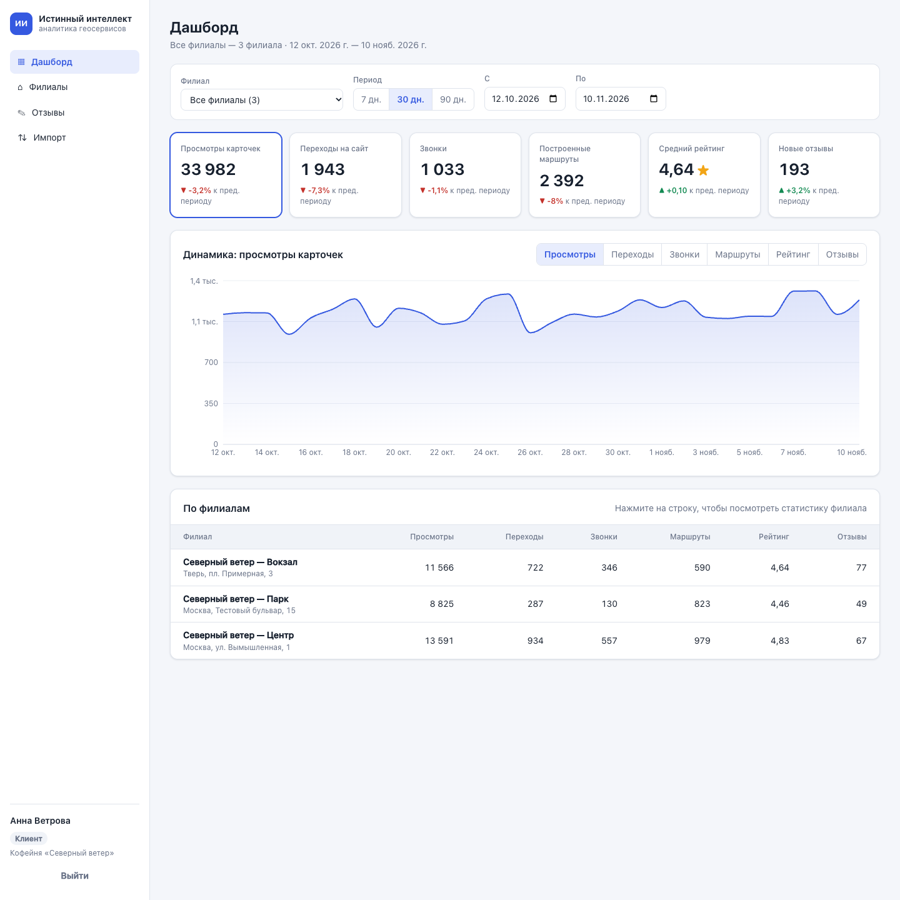 Клиент видит только свою компанию |
| 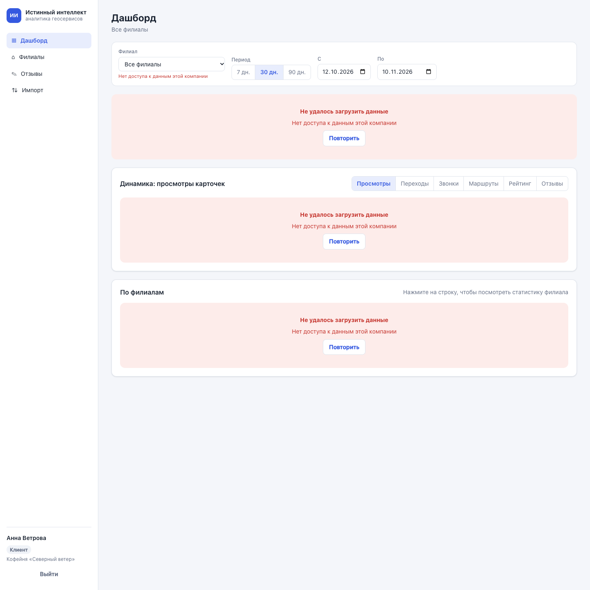 Клиент подставил чужой `companyId` в URL → 403 | 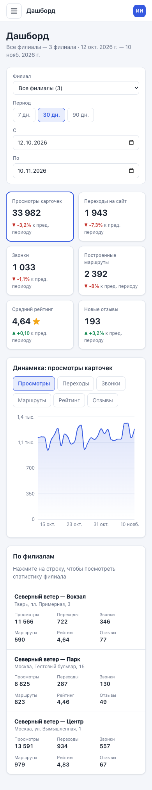 Мобильная вёрстка |
| 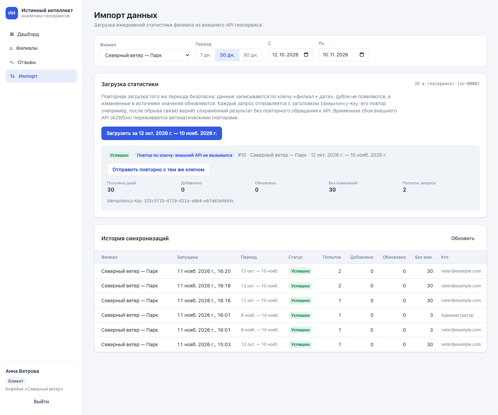 Импорт: повтор с тем же `Idempotency-Key` возвращает сохранённый результат | 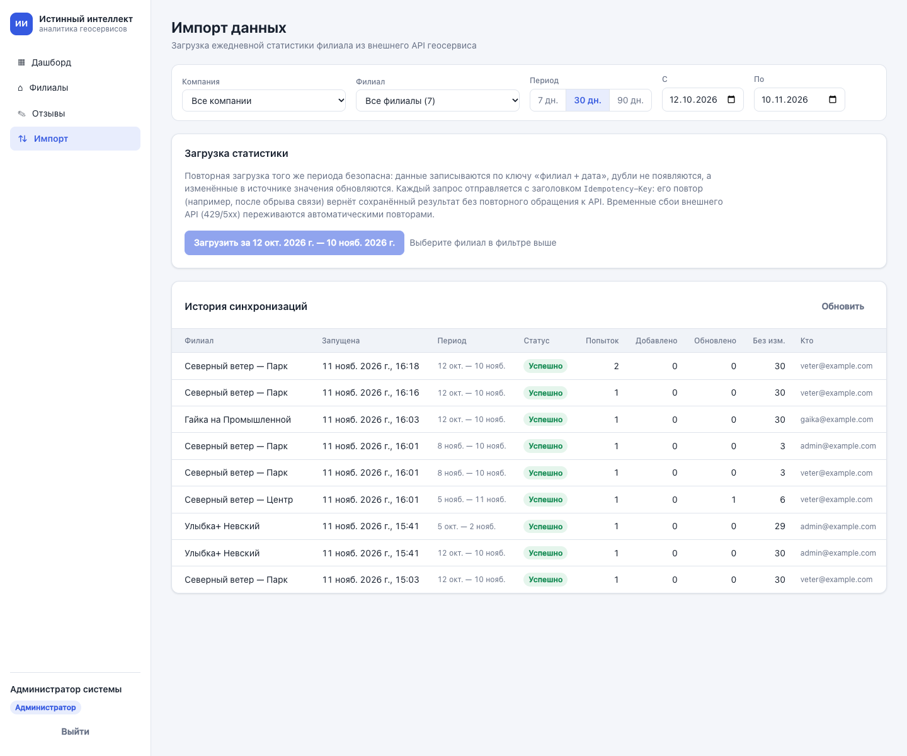 История синхронизаций (администратор) |
| 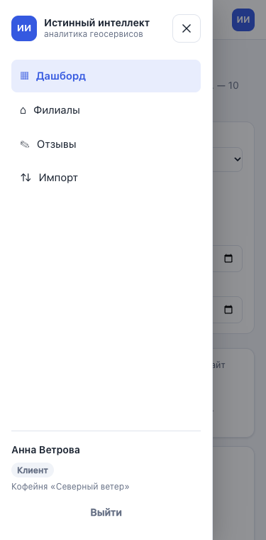 Мобильное меню (кнопка ☰) | 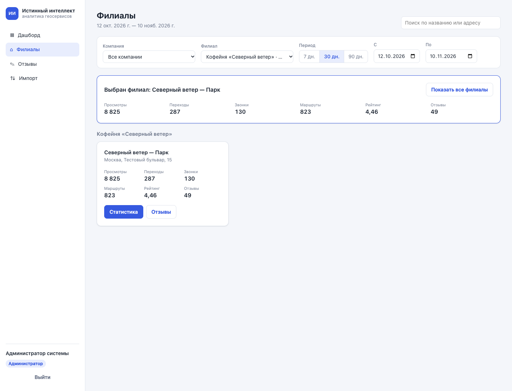 Страница «Филиалы» с выбранным филиалом |

---

## Что реализовано

### 1. Авторизация и роли
- Вход по email и паролю. Пароли хранятся как bcrypt-хеш, сессия передаётся JWT-токеном (Bearer, срок жизни 8 часов).
- Две роли: `admin` видит всё, `client` привязан к одной компании. Это закреплено CHECK-ограничением в БД: у клиента `company_id` обязателен, у администратора его быть не может.
- **Права проверяются на сервере.** Глобальный `JwtAuthGuard` защищает все эндпоинты, кроме `/auth/login` и `/health`. Роль и компания при каждом запросе перечитываются из БД, а не берутся из токена, поэтому изменение прав действует сразу.
- Вся фильтрация по правам сосредоточена в одном месте: `AccessScopeService`, [backend/src/access/access-scope.service.ts](backend/src/access/access-scope.service.ts). Он превращает «пользователь + запрошенные `companyId`/`branchId`» в итоговую область видимости, и каждый SQL-запрос фильтрует данные по ней:
  - клиент запросил чужую компанию → **403**;
  - клиент запросил чужой филиал или отзыв → **404**: факт существования объекта не раскрывается;
  - если клиент не передал фильтр, область всё равно ограничивается его компанией.
- Вход защищён от типовых утечек:
  - время ответа не зависит от того, существует ли email;
  - адрес возврата после входа (`?next=`) проверяется, внешние сайты отбрасываются;
  - секрет JWT не может быть общеизвестным: см. «Быстрый старт».

### 2. Аналитический дашборд
- Шесть KPI за период и изменение каждого к предыдущему периоду такой же длины.
- Фильтры: компания (только у администратора), филиал, период (7/30/90 дней или произвольные даты). Фильтры хранятся в URL: ссылкой можно поделиться, они сохраняются при перезагрузке и переходе между разделами.
- График динамики по дням для любого из шести показателей (Recharts). Показатель переключается кнопками над графиком или кликом по карточке KPI.
- Быстрые периоды заканчиваются вчерашним днём: данные за текущие сутки ещё неполные. Если за выбранный период данных нет, вместо нулей показывается сообщение со ссылкой на импорт. Если данных нет за предыдущий период, в карточках написано «нет данных для сравнения».

### 3. Филиалы
- Страница «Филиалы»: список доступных филиалов с показателями за период, поиск, итог по всем доступным филиалам, переход к статистике и отзывам филиала. Если в фильтре выбран филиал, на странице остаётся только он, а кнопка «Показать все филиалы» возвращает полный список.
- На дашборде таблица по филиалам: клик по строке переключает дашборд на этот филиал, повторный клик возвращает агрегат.

### 4. Backend и БД
- Миграция: [backend/src/database/migrations](backend/src/database/migrations). Сид: [backend/src/database/seed.ts](backend/src/database/seed.ts).
- Сид детерминированный (PRNG с фиксированным seed). Он создаёт 3 компании, 7 филиалов, 4 пользователя и показатели за 180 дней (около 1 260 строк), а также около 2 500 отзывов. Данные согласованы между собой: `reviews_count` за день равен числу отзывов за этот день, а оценки отзывов распределены вокруг рейтинга карточки.

### 5. Дополнительно (А): модуль отзывов
- Фильтры по рейтингу (несколько значений: `?rating=1,2`), статусу (`new` / `in_progress` / `resolved`) и филиалу, пагинация. На вкладках показаны счётчики по статусам с учётом остальных фильтров.
- Смена статуса и ответ на отзыв (`PATCH /reviews/:id`). Статус `resolved` проставляет `processed_at`.

### 6. Дополнительно (Б): получение статистики из внешнего API

**Имитация API** ([backend/src/mock-geo](backend/src/mock-geo)) — отдельный процесс на голом `node:http`: `GET /v1/locations/:id/daily-stats?date_from&date_to` с заголовком `X-Api-Key`. Она ведёт себя как реальный внешний сервис:
- собственные имена полей (`impressions`, `phone_calls`, …), backend делает маппинг;
- детерминированные данные: один и тот же запрос даёт один и тот же ответ;
- данные за текущий день неполные и растут в течение суток;
- случайные сбои 503 и 429 с `Retry-After` и сетевые задержки;
- ограничения на период (не больше 93 дней, без будущих дат).

**Импорт** (`POST /api/sync`, страница «Импорт», [backend/src/sync](backend/src/sync)): филиал связан с локацией геосервиса через `branches.external_id`, каждая загрузка фиксируется в журнале `sync_jobs`. Повторные запросы обрабатываются на нескольких уровнях:

| Ситуация | Поведение |
|---|---|
| Повторная загрузка того же периода | upsert по `UNIQUE(branch_id, date)`: дублей нет. `ON CONFLICT … DO UPDATE … WHERE (…) IS DISTINCT FROM (…)` не трогает неизменившиеся строки. В ответе — счётчики «добавлено / обновлено / без изменений» |
| Значения в источнике изменились (например, данные за сегодня дополнились) | обновляются только изменившиеся дни |
| Повтор запроса с тем же `Idempotency-Key` (обрыв связи, двойной клик) | возвращается сохранённый результат (200, `Idempotent-Replayed: true`), внешний API повторно не вызывается. Ключ привязан к пользователю |
| Тот же ключ, но другие параметры | 422 |
| Тот же ключ, пока первый запрос ещё выполняется | 409 |
| Два одновременных запуска для одного филиала | 409. Гарантия на уровне БД: частичный уникальный индекс `sync_jobs(branch_id) WHERE status = 'running'`, без гонок |
| Временный сбой API (429, 5xx, таймаут, сеть) | до 4 попыток с экспоненциальной задержкой и джиттером, учитывается `Retry-After` |
| API недоступен после всех попыток | 502 с понятной причиной, задача помечается `failed`, данные не меняются, филиал не блокируется. Повтор с тем же ключом выполняет запрос заново: ошибка не «замораживается» за ключом |
| Ответ не соответствует контракту (отрицательные значения, чужие даты, дубли дат) | весь ответ отклоняется (502), в БД не пишется ни одной строки |
| Процесс упал посреди синхронизации | «зависшая» задача через 10 минут считается прерванной и освобождает филиал |

Сетевой вызов выполняется вне транзакции БД, а запись — в одной транзакции. Права те же, что везде: клиент синхронизирует и видит журнал только своих филиалов. Филиал без `external_id` → 422. Для демонстрации один филиал («Гайка на Объездной») оставлен неподключённым.

История подключённых филиалов в сиде сгенерирована тем же генератором, что и в имитации API (как будто она уже была загружена раньше). Поэтому импорт поверх неё показывает «без изменений», а не перезаписывает данные.

### Обязательные требования
- Frontend делает реальные запросы к backend, данные сохраняются в PostgreSQL.
- Права проверяются на сервере (см. выше). Входные данные валидируются через `class-validator`, а неизвестные параметры отклоняются (`forbidNonWhitelisted`).
- Обработка ошибок и загрузки:
  - скелетоны при первой загрузке и индикатор «Обновление…» при повторной (старые данные остаются на экране);
  - ошибки с кнопкой «Повторить»;
  - пустые состояния;
  - сообщение «Не удалось связаться с сервером» при сетевой ошибке;
  - при 502/503 показывается причина от сервера (например, «внешний API недоступен после 4 попыток»).

  При истёкшей сессии (401) пользователь попадает на `/login` с сообщением «Сессия истекла» и после входа возвращается на исходную страницу. Явный выход ведёт на чистую страницу входа, чтобы следующий пользователь не попал на адрес предыдущего.
- **Тесты: 53 штуки, 5 наборов.**
  - [backend/test/external-sync.e2e-spec.ts](backend/test/external-sync.e2e-spec.ts) (вариант Б): e2e с имитацией API, запущенной в том же процессе. Проверяет:
    - сохранение данных с маппингом полей;
    - повторную загрузку без дублей и без перезаписи неизменившихся строк (сверяется `updated_at`);
    - исправление расхождений и перекрывающиеся периоды;
    - дополнение данных за сегодня;
    - `Idempotency-Key`: повтор без вызова API, 422 на другие параметры, изоляция ключей между пользователями;
    - параллельные запуски (409) и двойную отправку с одним ключом (API вызывается один раз);
    - ретраи при 503, исчерпание попыток, отклонение некорректного ответа без частичной записи;
    - права доступа и валидацию.

    Что тесты действительно ловят ошибки, проверено намеренной поломкой кода. Если убрать в upsert условие `IS DISTINCT FROM`, это обнаружат 4 теста; если отключить повтор по ключу — тоже 4. На рабочем коде все тесты проходят.
  - [backend/test/data-isolation.e2e-spec.ts](backend/test/data-isolation.e2e-spec.ts): e2e на реальном PostgreSQL. Проверяет изоляцию данных компаний A и B во всех эндпоинтах: списки, сводка, динамика, разбивка по филиалам, отзывы, изменение чужого отзыва (плюс проверка, что запись в БД не изменилась), подмену `companyId`/`branchId`, симметричный случай для клиента B, права администратора, фильтры отзывов и валидацию. Что тест действительно ловит утечку, проверено намеренной поломкой: если убрать принудительное ограничение клиента своей компанией, это обнаружат 8 тестов.
  - [backend/src/access/access-scope.service.spec.ts](backend/src/access/access-scope.service.spec.ts): unit-тесты политики доступа.
  - [backend/src/auth/jwt-secret.spec.ts](backend/src/auth/jwt-secret.spec.ts): выбор ключа подписи JWT; известные и короткие ключи в production отвергаются.
  - Регрессионные e2e-проверки по итогам ревью: некорректный ввод (переполнение id, несуществующие даты, `page=1e300`, `status: null`) даёт 400/404, а не 500; клиент не видит email администратора в журнале импорта.
  - [backend/src/common/period.spec.ts](backend/src/common/period.spec.ts): расчёт и валидация периодов.

---

## Архитектура

```
┌──────────────────────┐   HTTPS/JSON    ┌───────────────────────────────┐      ┌──────────────┐
│  Next.js (App Router)│ ──────────────▶ │ NestJS REST API  /api         │ ───▶ │ PostgreSQL   │
│  клиентские страницы │  Bearer JWT     │  JwtAuthGuard (глобальный)    │ SQL  │  миграции    │
│  фильтры в URL       │                 │  AccessScopeService ← все     │      │  TypeORM     │
│  useApi (abort,      │ ◀────────────── │   модули берут scope отсюда   │      └──────────────┘
│  reload, ошибки)     │                 │  Companies/Branches/Metrics/  │
└──────────────────────┘                 │  Reviews/Sync · ValidationPipe│
                                         └───────────────┬───────────────┘
                                                         │ HTTP + X-Api-Key, ретраи
                                                         ▼
                                         ┌───────────────────────────────┐
                                         │ geo-mock: имитация внешнего   │
                                         │ API геосервиса (сбои, 429)    │
                                         └───────────────────────────────┘
```

**Backend** ([backend/src](backend/src)):

| Модуль | Назначение |
|---|---|
| `auth` | логин, `/auth/me`, глобальный guard, декораторы `@Public` и `@CurrentUser` |
| `access` | `AccessScopeService`: единая политика доступа к данным |
| `companies`, `branches` | справочники с учётом прав |
| `metrics` | `summary`, `timeseries`, `by-branch`: агрегаты считаются в SQL (`SUM`/`AVG`, `generate_series` для дней без данных) |
| `reviews` | список с фильтрами и обновление статуса/ответа |
| `sync` | `GeoApiClient` (таймауты, ретраи, валидация ответа), `SyncService` (идемпотентность, журнал, upsert), CLI `sync-all` |
| `mock-geo` | имитация внешнего API; в compose запускается тем же образом как отдельный сервис |
| `database` | сущности, миграции, сид, `migrate.ts` |

Аналитические запросы написаны на SQL, а не через ORM. Так агрегаты считает база, а клиент получает уже готовые цифры. Имя колонки в динамическом SQL берётся только из белого списка `METRIC_SQL`, остальные значения передаются параметрами.

**Схема БД:**

```
companies (id, name)
users     (id, email UNIQUE, password_hash, full_name, role user_role, company_id → companies NULL,
           CHECK admin ⇔ company_id IS NULL)
branches  (id, company_id → companies, name, city, address, external_id UNIQUE NULL)  idx(company_id)
daily_metrics (id, branch_id → branches, date, views, website_clicks, calls, routes,
               rating NUMERIC(3,2), reviews_count, UNIQUE(branch_id, date))    idx(date)
reviews   (id, branch_id → branches, source, author_name, rating 1..5, text,
           status review_status, reply, published_at, processed_at)
           idx(branch_id, published_at DESC), idx(branch_id, status)
sync_jobs (id, branch_id → branches, date_from, date_to, status sync_status, idempotency_key,
           requested_by → users NULL, attempts, fetched, inserted, updated, unchanged, error,
           started_at, finished_at, UNIQUE(requested_by, idempotency_key))
           UNIQUE(branch_id) WHERE status = 'running', idx(branch_id, started_at DESC)
```

Уникальный ключ `(branch_id, date)` делает импорт статистики идемпотентным (`INSERT … ON CONFLICT DO UPDATE`).

**REST API** (все пути с префиксом `/api`; всё, кроме login и health, требует `Authorization: Bearer`):

| Метод | Путь | Параметры |
|---|---|---|
| POST | `/auth/login` | `{ email, password }` → `{ accessToken, user }` |
| GET | `/auth/me` | |
| GET | `/companies`, `/companies/:id` | |
| GET | `/branches`, `/branches/:id` | `companyId` |
| GET | `/metrics/summary` | `companyId, branchId, from, to` (YYYY-MM-DD; по умолчанию последние 30 дней) |
| GET | `/metrics/timeseries` | то же + `metric` = `views│websiteClicks│calls│routes│rating│reviewsCount` |
| GET | `/metrics/by-branch` | `companyId, branchId, from, to` |
| GET | `/reviews` | `companyId, branchId, rating=1,2, status, from, to, page, limit≤100` |
| PATCH | `/reviews/:id` | `{ status?, reply? }` |
| POST | `/sync` | `{ branchId, from?, to? }` (по умолчанию последние 7 дней, не больше 93) + заголовок `Idempotency-Key`. Ответ: 201 — новая загрузка, 200 — повтор |
| GET | `/sync/jobs` | `companyId, branchId, limit≤100` |
| GET | `/health` | |

Коды ошибок:
- 400 — валидация: id вне диапазона INT, даты вне 2000–2100, период больше 366 дней (для импорта — больше 93 дней или будущие даты);
- 401;
- 403 — чужая компания;
- 404 — чужой или несуществующий объект;
- 409 — синхронизация уже выполняется;
- 422 — ключ идемпотентности с другими параметрами или филиал не подключён;
- 502 — внешний API недоступен или вернул некорректные данные.

**Frontend** ([frontend/src](frontend/src)): страницы `login`, `(app)/dashboard`, `(app)/branches`, `(app)/reviews`, `(app)/sync`. Общие части:
- `lib/api.ts`: fetch-клиент с обработкой ошибок и 401;
- `lib/use-api.ts`: хук загрузки с отменой устаревших запросов;
- `lib/filters.ts`: фильтры в URL;
- `lib/auth.tsx`: контекст сессии.

Стили написаны на чистом CSS с переменными, есть светлая и тёмная тема и адаптивная вёрстка от 320px:
- на ширине ≤900px боковое меню заменяется верхней панелью с кнопкой ☰ и выезжающим меню (закрывается по Esc, клику на затемнение и при переходе);
- таблицы в узком контейнере превращаются в карточки (container queries);
- вёрстка проверена автоматическим проходом по 12 ширинам: нет горизонтальной прокрутки страницы и таблиц.

---

## Известные ограничения

- **Токен хранится в `localStorage`.** Это проще для MVP, но уязвимо к XSS. В продакшене лучше httpOnly secure cookie с refresh-токеном и CSRF-защитой. Нет отзыва токенов и logout на сервере. Блокировку пользователя через удаление учётки guard учитывает сразу.
- Нет ограничения частоты попыток входа (rate limiting) и нет блокировки после неудачных попыток. Время ответа при входе от существования email не зависит, поэтому перебором email нельзя узнать, какие учётные записи есть.
- Нет управления пользователями, компаниями и филиалами через UI или API: только сид.
- Реального геосервиса нет: статистика приходит из имитации API (вариант Б), а история за 180 дней создаётся сидом. Даты сида отсчитываются от дня первого запуска. Новые дни появляются только после импорта (страница «Импорт» или `sync-all`), автоматического расписания нет. Пересоздать данные: `docker compose exec backend node dist/database/seed.js --reset`.
- Импорт без `from`/`to` подставляет период «последние 7 дней» на сервере. Если повторить такой запрос с тем же `Idempotency-Key` после полуночи UTC, получится 422, потому что период уже другой. Интерфейс всегда передаёт даты явно.
- Даты считаются в UTC (дни `daily_metrics`, пресеты периодов). Часовые пояса филиалов не учитываются. Быстрые периоды (7/30/90 дней) заканчиваются вчерашним днём, потому что данные за текущие сутки неполные. Сегодняшний день можно выбрать вручную.
- Импорт (вариант Б) выполняется синхронно в рамках HTTP-запроса: пока идут ретраи, клиент ждёт до нескольких секунд. Для MVP это приемлемо, при росте нужна очередь (см. ниже). Автоматического расписания внутри приложения нет: есть CLI `sync-all` для внешнего cron.
- Из внешнего API импортируется только дневная статистика. Тексты отзывов не импортируются, поэтому `reviews_count` из API и записи в модуле отзывов согласованы только в данных сида.
- `Idempotency-Key` хранятся бессрочно; в продакшене их нужно чистить по TTL (например, через 24 часа).
- «Средний рейтинг за период» — это среднее дневных снимков рейтинга карточки, а в агрегате по нескольким филиалам — среднее по всем филиало-дням, без взвешивания по числу отзывов.
- Модуль отзывов показывает отзывы за всё время, фильтра по периоду в UI нет, хотя API его поддерживает. Нет истории изменений статуса и автора ответа.
- График строится только по дням. Для периодов больше 90 дней стоит добавить агрегацию по неделям и месяцам.
- Frontend без автотестов, тесты есть только у backend. UI проверен вручную и сценарием в headless-браузере, им же сняты скриншоты.
- `NEXT_PUBLIC_API_URL` фиксируется при сборке образа frontend. Для другого адреса API образ нужно пересобрать (`docker compose build --build-arg …`) или проксировать `/api` через reverse proxy.

---

## Масштабирование до 500+ компаний и нескольких тысяч филиалов

Оценка объёма: 5 000 филиалов × 365 дней ≈ **1,8 млн строк `daily_metrics` в год**, отзывов на порядок больше. Для PostgreSQL это немного. Узким местом станут не данные, а агрегатные запросы при множестве одновременных пользователей и загрузка данных из внешних API.

1. **Данные и запросы**
   - Перейти на `BIGINT`-идентификаторы, а `daily_metrics` разбить на партиции по месяцам (`PARTITION BY RANGE (date)`). Старые партиции отсоединять в архив.
   - Добавить `company_id` в `daily_metrics` и `reviews` (денормализация). Тогда фильтр по компании не требует join с `branches`, а индекс `(company_id, date)` закрывает основные запросы дашборда.
   - Ввести предагрегаты: материализованные таблицы `weekly/monthly_metrics` и сводку «компания × день». Их стоит обновлять инкрементально после каждой загрузки, а не через `REFRESH` всей таблицы. Дашборд за год тогда читает 12–52 строки на филиал вместо 365.
   - Если аналитика сильно разрастётся (почасовые данные, произвольные срезы), вынести её в колоночное хранилище (ClickHouse или TimescaleDB с continuous aggregates). PostgreSQL при этом остаётся источником истины для пользователей, прав и отзывов.
   - Для отзывов использовать keyset-пагинацию по `(published_at, id)` вместо `OFFSET` и полнотекстовый поиск (GIN по `tsvector`).
2. **Изоляция арендаторов.** Сохранить единый `AccessScopeService` и добавить **Row-Level Security** в PostgreSQL: `SET app.company_id` в транзакции запроса и политики `USING (company_id = current_setting(...))`. Это второй рубеж защиты на случай ошибки в коде. Тест изоляции нужно автоматически прогонять по всем новым эндпоинтам.
3. **Загрузка статистики.** Логику варианта Б (идемпотентный upsert, журнал `sync_jobs`, блокировка параллельных запусков, ретраи) можно переиспользовать, но выполнение нужно вынести из HTTP-запроса в отдельные воркеры с очередью задач (BullMQ/Redis или pg-boss). Тогда `POST /sync` только ставит задачу и сразу отвечает 202, а UI опрашивает её статус. Ещё понадобятся:
   - планировщик, который распределяет тысячи филиалов по окну загрузки;
   - общий rate limiter на каждый геосервис (token bucket в Redis);
   - circuit breaker при массовых сбоях источника;
   - пакетные эндпоинты внешнего API (много локаций за запрос), если они есть;
   - хранение сырых ответов для повторной обработки без обращения к API.
4. **API и кэш.** Кэшировать ответы аналитики в Redis по ключу `scope + period + metric` и сбрасывать кэш по событию «данные филиала обновлены». Сегодняшние данные держать с коротким TTL. Backend без состояния масштабируется горизонтально, за ним — пул соединений (PgBouncer) и read-реплики для аналитических запросов.
5. **Роли и доступ.** Перейти к модели «пользователь ↔ компании ↔ филиалы» (many-to-many) с ролями внутри компании: владелец, менеджер сети, управляющий филиалом. Добавить агентские аккаунты с доступом к нескольким компаниям, SSO и аудит-лог действий.
6. **UI для больших сетей.** Поиск и виртуализированный список вместо `<select>` на сотни филиалов, группировка по городам и регионам, сравнение филиалов, серверная пагинация и сортировка таблицы по филиалам.
7. **Эксплуатация.** Нужны структурированные логи, метрики (Prometheus/Grafana), трассировка, алерты на задержку загрузки данных, нагрузочные тесты дашборда, CI с e2e-тестом изоляции как обязательной проверкой и управление секретами (JWT-ключи с ротацией).

---

## Структура репозитория

```
backend/            NestJS API, миграции, сид, тесты
  src/access/       политика доступа (AccessScopeService)
  src/sync/         импорт статистики из внешнего API (вариант Б)
  src/mock-geo/     имитация внешнего API геосервиса
  src/database/     сущности, миграции, сид
  test/             e2e: изоляция данных, импорт из внешнего API
frontend/           Next.js приложение
docker/postgres/    init-скрипт (создание тестовой БД)
docs/screenshots/   скриншоты
docker-compose.yml  db + geo-mock + backend + frontend (+ профиль tests)
```
